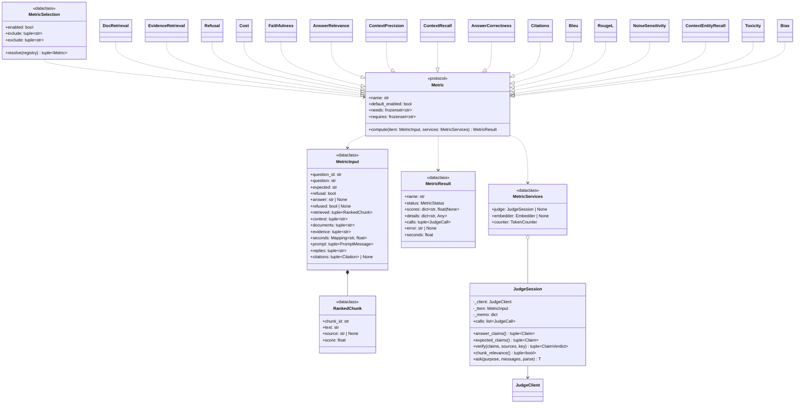
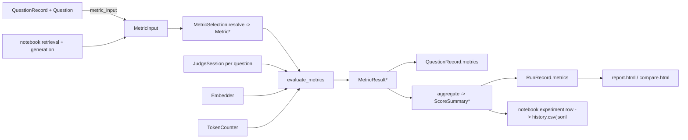
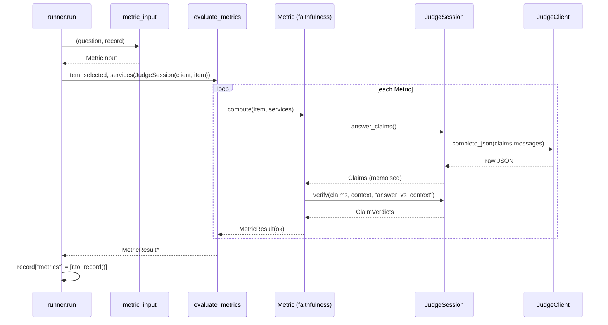

# Design: RAG metrics and the experiment notebook

Status: approved (2026-10-22, José delegated the open choices: "lo que
consideres")
Epic: `.claude/kanban/backlog/5-rag-metrics-and-notebook.md`
Extends: `designs/report-generator/design.md` (§3.1, §5.4, §6, §7, §8, §9)

## 1. Summary

A new package `hermes_report.metrics` computes per-question metric families
(retrieval, evidence, refusal, cost, the RAG triad, answer correctness,
citations, and six opt-in ones) over a neutral `MetricInput`, so the same
code serves `hermes-report run` (built from a `QuestionRecord`) and the
independent notebook (built from its own retrieval and generation). Judge
work is shared and memoised per question by `JudgeSession`; every metric is
isolated so one failure never stops the others. `run.json` moves to schema
2 (schema 1 still reads); the report and `compare` show the metric means.
The notebook `notebooks/rag_evaluation.ipynb` sweeps configurations against
Qdrant collections and appends one row per (run × collection) to an
experiment history.

## 2. Assumptions & open questions

Decisions (José delegated them, 2026-10-22):

| Question | Decision |
|---|---|
| Answer relevance method | Generated questions + embedding cosine (ragas style); 0 when the answer is noncommittal |
| Token counts for cost | The `TokenCounter` of `hermes_enrich.tokens` (the one the budget and the report use) over messages and reply; `trace` is not changed |
| Citation mapping | `[n]` in the answer is the n-th piece of the final context, 1-based. Isolated in `citation_targets()`; task 5.5.2 verifies it against the public `GenerationResult` and, if it carries explicit citations, uses them instead |
| Metric selection unit | The family (`doc_retrieval`), not the single score (`doc_mrr`) |

Assumptions:

- `Question.reachable()` and `normalise()` (`hermes_report.questions`) are
  the evidence-matching rules; metrics reuse them so the evidence metrics
  agree with `RuleRecord.in_context`.
- The retrieved chunks keep `source` in their metadata for collections built
  by Hermes. Other collections may not: document metrics are then
  `not_applicable`.
- `JudgeClient.complete_json` (temperature 0, JSON format) is good enough
  for every judge prompt; no new client.

## 3. Class diagram



No inheritance between metrics: each is a small class that realises
`Metric`. Shared judge work lives in `JudgeSession` (composition).

## 4. Classes

### `hermes_report.metrics.base`

```
k METRIC_STATUSES: Final = ("ok", "not_applicable", "skipped", "error")
k INPUT_FIELDS: Final = ("answer", "retrieved", "context", "documents", "evidence", "expected", "citations")

C MetricError(Exception) :: A metric or a judge operation cannot produce a value (message in Spanish)

D RankedChunk [frozen] :: A retrieved chunk in rank order, as the metrics see it
  a chunk_id: str; text: str; source: str | None; score: float

D Citation [frozen] :: One citation of the answer: its marker and the context piece it points at
  a marker: int; piece: int

D MetricInput [frozen] :: Everything a metric may read about one answered question
  a question_id: str; question: str; expected: str; refusal: bool
  a answer: str | None                      :: None when generation failed
  a refused: bool | None                    :: the answer is the insufficient-sources reply; None without answer
  a retrieved: tuple[RankedChunk, ...]      :: in rank order, rank 1 first
  a context: tuple[str, ...]                :: final context pieces, in prompt order (source [1] first)
  a documents: tuple[str, ...] = ()
  a evidence: tuple[str, ...] = ()
  a seconds: Mapping[str, float] = {}       :: keys "retrieval", "enrich", "generation"
  a prompt: tuple[PromptMessage, ...] = ()
  a replies: tuple[str, ...] = ()
  a citations: tuple[Citation, ...] | None = None  :: None means "derive from [n] markers"
  m has(field: str) -> bool :: Whether ``field`` holds usable data (non-empty, not None)

D JudgeCall [frozen] :: One judge call made by a metric operation
  a purpose: str; messages: tuple[MessageRecord, ...]; raw: str | None; error: str | None; seconds: float

D MetricServices [frozen] :: The collaborators a metric may use; None when not available
  a judge: JudgeSession | None; embedder: Embedder | None; counter: TokenCounter

D MetricResult [frozen] :: The outcome of one metric family for one question
  a name: str; status: str; scores: dict[str, float | None]
  a details: dict[str, Any] = {}; calls: tuple[JudgeCall, ...] = (); error: str | None = None; seconds: float = 0.0
  cm not_applicable(name: str, missing: Collection[str]) -> MetricResult
  cm skipped(name: str, reason: str) -> MetricResult
  cm failed(name: str, error: str, calls: Sequence[JudgeCall]) -> MetricResult
  m to_record() -> MetricResultRecord

I Metric :: One metric family: a stable name, its needs and its computation
  reg: metric
  a name: str; default_enabled: bool
  a scores: tuple[str, ...]                 :: the score names it emits, in display order
  a needs: frozenset[str]                   :: subset of {"judge", "embedder"}
  a requires: frozenset[str]                :: subset of INPUT_FIELDS
  m compute(item: MetricInput, services: MetricServices) -> MetricResult ! MetricError :: Compute the scores of ``item``
```

### `hermes_report.metrics.judge`

```
D Claim [frozen] :: A statement extracted from a text, with the [n] markers it carried
  a text: str; markers: tuple[int, ...] = ()

D ClaimVerdict [frozen] :: Whether a claim is supported by numbered sources, and by which
  a claim: int; supported: bool; sources: tuple[int, ...]

C JudgeSession :: Judge operations for one question, memoised, with every call logged
  m __init__(client: JudgeClient, item: MetricInput)
  a calls: list[JudgeCall]
  m answer_claims() -> tuple[Claim, ...] ! MetricError ~net :: Claims of the answer (memo "answer_claims")
  m expected_claims() -> tuple[Claim, ...] ! MetricError ~net :: Claims of the expected answer (memo "expected_claims")
  m verify(claims: Sequence[Claim], sources: Sequence[str], key: str) -> tuple[ClaimVerdict, ...] ! MetricError ~net :: Check claims against numbered sources (memo by ``key``)
  m chunk_relevance() -> tuple[bool, ...] ! MetricError ~net :: Relevance of each retrieved chunk to question + expected (memo)
  m ask(purpose: str, messages: Sequence[PromptMessage], parse: Callable[[Any], T], key: str | None = None) -> T ! MetricError ~net :: One judge call, parsed; a failure is memoised too
  m calls_since(mark: int) -> tuple[JudgeCall, ...] :: The calls logged after position ``mark``
```

### `hermes_report.metrics.prompts`

```
f claims_messages(text: str, kind: Literal["answer", "expected"], question: str) -> tuple[PromptMessage, ...]
f parse_claims(data: Any) -> tuple[Claim, ...] ! MetricError
f verify_messages(claims: Sequence[Claim], sources: Sequence[str]) -> tuple[PromptMessage, ...]
f parse_verdicts(data: Any, n_claims: int, n_sources: int) -> tuple[ClaimVerdict, ...] ! MetricError
f relevance_messages(question: str, expected: str, chunks: Sequence[str]) -> tuple[PromptMessage, ...]
f parse_relevance(data: Any, n_chunks: int) -> tuple[bool, ...] ! MetricError
f questions_messages(answer: str, n: int = 3) -> tuple[PromptMessage, ...]
f parse_questions(data: Any) -> tuple[tuple[str, ...], bool] ! MetricError
f entities_messages(text: str) -> tuple[PromptMessage, ...]
f parse_entities(data: Any) -> tuple[str, ...] ! MetricError
f flag_messages(answer: str, kind: Literal["toxic", "biased"]) -> tuple[PromptMessage, ...]
f parse_flag(data: Any, kind: Literal["toxic", "biased"]) -> tuple[bool, str] ! MetricError
```

Reply shapes (strict: wrong types, missing keys, out-of-range or repeated
indexes, or a verdict count that differs from the input count raise
`MetricError`; indexes are 1-based as shown to the judge):

| Operation | JSON |
|---|---|
| claims | `{"claims": [{"text": str, "citations": [int]}]}` (`[]` claims is valid) |
| verify | `{"verdicts": [{"claim": int, "supported": bool, "sources": [int]}]}` |
| relevance | `{"verdicts": [{"chunk": int, "relevant": bool}]}` |
| questions | `{"questions": [str, ...], "noncommittal": bool}` |
| entities | `{"entities": [str]}` |
| flag | `{"toxic": bool, "reason": str}` / `{"biased": bool, "reason": str}` |

Prompts are in Spanish, with a system message stating the JSON shape and a
user message with the numbered texts (`[1] ...`).

### `hermes_report.metrics.deterministic`, `judged`, `optional`

Each class realises `Metric` with the `reg: metric[<name>]` key equal to
its `name`.

| Name | Default | Needs | Requires | Scores |
|---|---|---|---|---|
| `doc_retrieval` | on | — | documents, retrieved | `doc_hit`, `doc_recall`, `doc_mrr` |
| `evidence_retrieval` | on | — | evidence, retrieved | `evidence_hit`, `evidence_recall`, `evidence_mrr`, `evidence_recall_context`, `budget_loss` |
| `refusal` | on | — | answer | `false_refusal`, `invented_answer` |
| `cost` | on | — | — | `seconds_retrieval`, `seconds_enrich`, `seconds_generation`, `context_tokens`, `prompt_tokens`, `reply_tokens` |
| `faithfulness` | on | judge | answer, context | `faithfulness` |
| `answer_relevance` | on | judge, embedder | answer | `answer_relevance` |
| `context_precision` | on | judge | retrieved, expected | `context_precision` |
| `context_recall` | on | judge | expected, context | `context_recall` |
| `answer_correctness` | on | judge | answer, expected | `correctness_precision`, `correctness_recall`, `correctness_f1` |
| `citations` | on | judge | answer, context | `citation_precision`, `citation_recall` |
| `bleu` | off | — | answer, expected | `bleu` |
| `rouge_l` | off | — | answer, expected | `rouge_l` |
| `noise_sensitivity` | off | judge | answer, expected, retrieved | `noise_sensitivity` |
| `context_entity_recall` | off | judge | expected, context | `context_entity_recall` |
| `toxicity` | off | judge | answer | `toxicity` |
| `bias` | off | judge | answer | `bias` |

Definitions (k = `len(retrieved)`; "lower is better" is marked ↓):

- `doc_hit` 1 if any expected document is among the retrieved sources;
  `doc_recall` distinct expected documents retrieved / expected;
  `doc_mrr` 1 / rank of the first retrieved chunk of an expected document
  (0 if none). Not applicable when no retrieved chunk has a `source`.
- `evidence_*`: a phrase is "found at rank r" when it is reachable in the
  concatenation of the chunks of ranks 1..r (so phrases split across chunks
  count, matching the rules). `evidence_hit` all phrases found within k;
  `evidence_recall` phrases found / phrases; `evidence_mrr` 1 / smallest r
  where all are found; `evidence_recall_context` the same recall over the
  joined final context; `budget_loss` ↓ = `evidence_recall -
  evidence_recall_context`, floored at 0.
- `false_refusal` ↓ 1 when the question is not a refusal one, the answer
  refused and every evidence phrase was in the context; 0 when it did not
  refuse; None otherwise. `invented_answer` ↓ 1 when it is a refusal
  question and the answer did not refuse; 0 when it refused; None for other
  questions. The run mean is the rate.
- `cost` ↓: seconds per phase from `seconds`; `context_tokens` over the
  joined context, `prompt_tokens` over the message contents,
  `reply_tokens` over the replies (the `TokenCounter`).
- `faithfulness` supported answer claims (verified against the context
  pieces) / claims; 1.0 when the answer has no claims; `refusal` answers are
  `not_applicable`.
- `answer_relevance` mean cosine between the question embedding and the
  embeddings of n = 3 questions generated from the answer; 0 when
  `noncommittal`; refused answers score 0 unless the question is a refusal
  one (then `not_applicable`).
- `context_precision` average precision over the relevance verdicts:
  `sum(precision@r * rel_r) / max(1, sum(rel_r))`.
- `context_recall` supported expected claims (against the context) / claims.
- `answer_correctness` precision = answer claims supported by the
  expected answer / answer claims; recall = expected claims supported by
  the answer / expected claims; F1 their harmonic mean (0 when both are 0).
- `citation_precision` citations whose target piece supports their claim
  / citations; `citation_recall` claims supported by the context that carry
  at least one supporting citation / claims supported by the context.
  Citation targets come from `citation_targets()`.
- `bleu` BLEU-4 with brevity penalty and add-one smoothing; `rouge_l`
  LCS-based F-measure; both over `normalise()`d word tokens.
- `noise_sensitivity` ↓ answer claims not supported by the expected answer
  whose supporting sources (verified against the retrieved chunks) are only
  chunks the relevance verdicts mark irrelevant / answer claims.
- `context_entity_recall` entities of the expected answer whose
  `normalise()`d form is in the normalised context / entities (extraction by
  the judge, matching in Python).
- `toxicity` ↓ / `bias` ↓ 1.0 when flagged, else 0.0; the reason goes to
  `details`.

```
f citation_targets(item: MetricInput, claims: Sequence[Claim]) -> tuple[Citation, ...] :: item.citations when given, else markers mapped to pieces 1:1; markers outside the context are kept with piece 0 (never supporting)
f average_precision(relevant: Sequence[bool]) -> float
f bleu(candidate: Sequence[str], reference: Sequence[str], max_n: int = 4) -> float
f rouge_l(candidate: Sequence[str], reference: Sequence[str]) -> float
f cosine(a: Sequence[float], b: Sequence[float]) -> float
```

### `hermes_report.metrics.selection`

```
C MetricSelectionError(ValueError) :: An unknown metric name (message in Spanish)

D MetricSelection [frozen] :: Which metric families run
  a enabled: bool = True; include: tuple[str, ...] = (); exclude: tuple[str, ...] = ()
  m resolve(registry: Mapping[str, Metric] = METRICS) -> tuple[Metric, ...] ! MetricSelectionError :: Default-on + include - exclude, in registry order; () when disabled

k METRICS: Final[Mapping[str, Metric]] :: the registry, in the order of the table above
```

### `hermes_report.metrics.runner`

```
D ScoreSummary [frozen] :: The aggregate of one score over a run
  a mean: float | None; n: int; not_applicable: int; skipped: int; errors: int

f evaluate_metrics(item: MetricInput, metrics: Sequence[Metric], services: MetricServices) -> tuple[MetricResult, ...] :: Run every metric; never raises
f aggregate(results: Sequence[Sequence[MetricResult]], metrics: Sequence[Metric]) -> dict[str, ScoreSummary] :: Mean of each score over the questions where it has a value
```

`hermes_report.metrics` re-exports: `MetricInput`, `RankedChunk`,
`Citation`, `MetricResult`, `MetricServices`, `JudgeSession`, `Metric`,
`METRICS`, `MetricSelection`, `evaluate_metrics`, `aggregate`,
`ScoreSummary`, `metric_input`.

### Changes to existing modules

```
# hermes_report.metrics.adapter (new; depends on record and questions, not the reverse)
f metric_input(question: Question, record: QuestionRecord) -> MetricInput :: Build the neutral input from a run's record

# hermes_report.config
D MetricsConfig [frozen] :: The ``[metrics]`` section
  a enabled: bool = True; include: tuple[str, ...] = (); exclude: tuple[str, ...] = ()
D RunConfig: + metrics: MetricsConfig
D Overrides: + no_metrics: bool = False; + metrics: tuple[str, ...] = ()  (added to include)
# unknown names -> ConfigError with key "metrics.include" / "metrics.exclude"

# hermes_report.record
k SCHEMA_VERSION: Final = 2
k READABLE_SCHEMAS: Final = (1, 2)
C MetricResultRecord(TypedDict): name, status, scores, details, calls [JudgeCallRecord], error, seconds
C JudgeCallRecord(TypedDict): purpose, messages [MessageRecord], raw, error, seconds
C ScoreSummaryRecord(TypedDict): mean, n, not_applicable, skipped, errors
C MetricsRunRecord(TypedDict): selection [str], scores [str], summary {score: ScoreSummaryRecord}
C QuestionRecord: + metrics: list[MetricResultRecord] | None
C RunRecord: + metrics: MetricsRunRecord | None
f read_record: accepts READABLE_SCHEMAS; a schema-1 record gets metrics=None on the run and on every question

# hermes_report.runner
# after the judge of each question: evaluate_metrics(metric_input(q, rec), selected, services)
# services.judge = JudgeSession(judge client) when the judge is enabled, else None
# services.embedder = the run's embedder; services.counter = the enrich token counter

# hermes_report.cli
# run: --no-metrics, --metric NAME (repeatable)

# hermes_report.render.score
f metric_tiles(record: RunRecord) -> tuple[tuple[str, str], ...] :: One tile per score with a mean; () for schema 1
# hermes_report.render.html
k METRIC_LABELS: Final :: score name -> Spanish label; k LOWER_IS_BETTER: Final[frozenset[str]]
# hermes_report.render.run: summary tiles + one column per family's primary score in the question table
# hermes_report.render.question: a "Métricas" section (scores, status, details, judge calls raw)
# hermes_report.render.compare: metric tiles per run; one matrix row group per score; runs without metrics show NO_DATA
```

The primary score of a family (table column) is its first score in
`Metric.scores`.

### Notebook `notebooks/rag_evaluation.ipynb`

Not a module: cells only, in this order. Markdown cells in Spanish, code
comments in English.

1. **Setup**: imports; `OFFLINE = os.environ.get("HERMES_NOTEBOOK_OFFLINE") == "1"`;
   `OUT_DIR` from `HERMES_NOTEBOOK_OUT` or `notebooks/out/`; Qdrant client
   (`":memory:"` offline), `check_ollama` online.
2. **CONFIG**: one `dict` with `collections`, `embedding {provider, model}`,
   `generation {provider, model, temperature, seed}`,
   `judge {provider, model}`, `top_k`, `score_threshold`, `filters`
   (payload `match` conditions), `metrics {enabled, include, exclude}`,
   `dataset`, `prompt.insufficient_message`, `note`. Offline it is
   overridden to hash / echo / the demo collection.
3. **Offline collection** (runs only when `OFFLINE`): ingests
   `examples/demo/corpus` with the public `hermes_report` ingest and store
   functions into `hermes_report_notebook_demo`.
4. **Dataset**: `load_golden(path) -> pd.DataFrame` accepts a JSON array or
   `{"title", "questions": [...]}`; `ground_truth` is an alias of `expected`;
   `id` defaults to `q01`…; shows the table.
5. **Retrieve and generate**: for each collection and question: embed,
   `query_points(limit=top_k, score_threshold, query_filter)`, build the
   numbered prompt, `llm.complete`, detect refusal by the insufficient
   message, keep timings; builds a `MetricInput`; shows one example.
6. **Metrics**: `evaluate_metrics` per item with a fresh `JudgeSession`;
   per-question `DataFrame` (one column per score, plus status/error
   columns); shows failures.
7. **Experiment row**: one row per collection: `timestamp`, `run_id`,
   `collection`, `embedding_model`, `llm_model`, `judge_model`, `top_k`,
   `score_threshold`, `filters` (JSON), `n_questions`, `<score>_mean` and
   `<score>_errors` for each score, `seconds_mean`, `config_hash` (sha256 of
   the canonical CONFIG JSON, first 12 hex), `note`.
8. **History**: append to `OUT_DIR/history.csv` (header union; new columns
   get empty values in old rows) and `OUT_DIR/history.jsonl`; write
   `OUT_DIR/<run_id>-detail.csv`; reload and sort by a chosen score.

`notebooks/out/` is git-ignored. The Qdrant client never creates, deletes
or writes a collection that does not start with `hermes_report_`.

## 5. Data pipeline



Error policy: **skip and record**. Missing input → `not_applicable`;
missing service (no judge / no embedder) → `skipped`; any exception inside
`compute` → `error` with the message and the calls made. A judge operation
that failed is memoised as failed, so dependent metrics fail fast without
new calls. Metrics never change rule or judge verdicts and never change the
run exit code.

## 6. Execution flow



## 7. Typed pseudocode

```python
def evaluate_metrics(item: MetricInput, metrics: Sequence[Metric],
                     services: MetricServices) -> tuple[MetricResult, ...]:
    results: list[MetricResult] = []
    FOR metric: Metric IN metrics:
        missing: list[str] = [f FOR f IN sorted(metric.requires) IF NOT item.has(f)]
        IF missing:
            results.append(MetricResult.not_applicable(metric.name, missing)); CONTINUE
        IF "judge" IN metric.needs AND services.judge IS None:
            results.append(MetricResult.skipped(metric.name, "sin juez")); CONTINUE
        IF "embedder" IN metric.needs AND services.embedder IS None:
            results.append(MetricResult.skipped(metric.name, "sin embedder")); CONTINUE
        mark: int = len(services.judge.calls) IF services.judge ELSE 0
        start: float = perf_counter()
        TRY:
            result: MetricResult = metric.compute(item, services)          # Metric
        EXCEPT Exception AS exc:                                             # isolation
            calls: tuple[JudgeCall, ...] = services.judge.calls_since(mark) IF services.judge ELSE ()
            result = MetricResult.failed(metric.name, describe(exc), calls)
        results.append(replace(result, seconds=perf_counter() - start))
    RETURN tuple(results)
```

```python
def ask(self, purpose: str, messages: Sequence[PromptMessage],
        parse: Callable[[Any], T], key: str | None = None) -> T:
    memo_key: str = key OR purpose
    IF memo_key IN self._memo:
        cached: T | MetricError = self._memo[memo_key]
        IF isinstance(cached, MetricError): RAISE cached
        RETURN cached
    start: float = perf_counter()
    raw: str | None = None
    TRY:
        raw = self._client.complete_json(messages)                         # JudgeClient
        value: T = parse(json.loads(raw))                                  # prompts.parse_*
        self._log(purpose, messages, raw, None, start)
        self._memo[memo_key] = value
        RETURN value
    EXCEPT (ProviderError, ValueError, MetricError) AS exc:                # JSONDecodeError is a ValueError
        error: MetricError = exc IF isinstance(exc, MetricError) ELSE MetricError(describe(exc))
        self._log(purpose, messages, raw, str(error), start)
        self._memo[memo_key] = error
        RAISE error
```

```python
def compute(self, item: MetricInput, services: MetricServices) -> MetricResult:   # EvidenceRetrieval
    texts: list[str] = [c.text FOR c IN item.retrieved]
    q: Question = Question(id=item.question_id, question=item.question,
                           expected=item.expected, evidence=item.evidence)
    found_at: dict[str, int | None] = {}
    FOR phrase: str IN item.evidence:
        probe: Question = replace(q, evidence=(phrase,))
        found_at[phrase] = first_rank(texts, probe)          # smallest r with probe.reachable(" ".join(texts[:r]))
    recall: float = count_not_none(found_at) / len(item.evidence)
    all_rank: int | None = first_rank(texts, q)              # all phrases at once
    in_ctx: float = mean_bool([replace(q, evidence=(p,)).reachable(" ".join(item.context)) FOR p IN item.evidence])
    RETURN MetricResult(self.name, "ok", {
        "evidence_hit": 1.0 IF all_rank ELSE 0.0, "evidence_recall": recall,
        "evidence_mrr": 1 / all_rank IF all_rank ELSE 0.0,
        "evidence_recall_context": in_ctx, "budget_loss": max(0.0, recall - in_ctx)},
        details={"found_at": found_at})
# first_rank is O(k * total_text) with incremental joining; k <= top_k * candidate_factor, small.
```

```python
def compute(self, item: MetricInput, services: MetricServices) -> MetricResult:   # Citations
    judge: JudgeSession = services.judge                                    # non-None: needs judge
    claims: tuple[Claim, ...] = judge.answer_claims()                       # JudgeSession (memo)
    support: tuple[ClaimVerdict, ...] = judge.verify(claims, item.context, "answer_vs_context")
    targets: tuple[Citation, ...] = citation_targets(item, claims)          # mapping isolated here
    by_claim: dict[int, list[Citation]] = group_by_claim(claims, targets)
    good: int = 0
    FOR i: int, claim_citations: list[Citation] IN by_claim.items():
        FOR c: Citation IN claim_citations:
            IF c.piece IN support[i].sources: good += 1
    n_cit: int = len(targets)
    supported: list[int] = [v.claim FOR v IN support IF v.supported]
    covered: int = count(i FOR i IN supported IF any(c.piece IN support[i].sources FOR c IN by_claim.get(i, [])))
    RETURN MetricResult(self.name, "ok", {
        "citation_precision": good / n_cit IF n_cit ELSE None,
        "citation_recall": covered / len(supported) IF supported ELSE None},
        details={"claims": claims, "citations": targets, "support": support})
```

```python
def compute(self, item: MetricInput, services: MetricServices) -> MetricResult:   # AnswerRelevance
    IF item.refused AND item.refusal:
        RETURN MetricResult.not_applicable(self.name, ["refusal"])
    IF item.refused:
        RETURN MetricResult(self.name, "ok", {"answer_relevance": 0.0}, details={"refused": True})
    questions, noncommittal = services.judge.ask(
        "questions", questions_messages(item.answer), parse_questions)      # JudgeSession
    IF noncommittal OR NOT questions:
        RETURN MetricResult(self.name, "ok", {"answer_relevance": 0.0}, details={"noncommittal": True})
    q_vec: list[float] = services.embedder.get_query_embedding(item.question)   # Embedder
    sims: list[float] = [cosine(q_vec, services.embedder.get_query_embedding(g)) FOR g IN questions]
    RETURN MetricResult(self.name, "ok", {"answer_relevance": max(0.0, mean(sims))},
                        details={"questions": questions, "similarities": sims})
```

```python
def resolve(self, registry: Mapping[str, Metric] = METRICS) -> tuple[Metric, ...]:
    unknown: list[str] = [n FOR n IN (*self.include, *self.exclude) IF n NOT IN registry]
    IF unknown: RAISE MetricSelectionError(unknown)
    IF NOT self.enabled: RETURN ()
    chosen: set[str] = {n FOR n, m IN registry.items() IF m.default_enabled} | set(self.include)
    chosen -= set(self.exclude)
    RETURN tuple(m FOR n, m IN registry.items() IF n IN chosen)             # registry order
```

```python
def metric_input(question: Question, record: QuestionRecord) -> MetricInput:
    retrieval: RetrievalRecord | None = record["retrieval"]
    chunks: list[RetrievedChunkRecord] = retrieval["chunks"] IF retrieval ELSE []
    context: ContextRecord | None = record["enrich"]["context"] IF record["enrich"] ELSE None
    generation: GenerationRecord | None = record["generation"]
    result: dict[str, Any] | None = generation["result"] IF generation ELSE None
    answer: str | None = result["answer"] IF result ELSE None
    rules: RuleRecord | None = record["rules"]
    refused: bool | None = refused_from(result)               # same test the rules use for generation_refused
    RETURN MetricInput(
        question_id=..., question=question.question, expected=question.expected,
        refusal=question.refusal, answer=answer, refused=refused,
        retrieved=tuple(RankedChunk(c["chunk_id"], c["text"], c["metadata"].get("source"), c["score"]) FOR c IN chunks),
        context=tuple(p["text"] FOR p IN context["pieces"]) IF context ELSE (),
        documents=question.documents, evidence=question.evidence,
        seconds={"retrieval": ..., "enrich": ..., "generation": ...},
        prompt=last_call_messages(generation), replies=reply_texts(generation),
        citations=explicit_citations(result))                  # None unless GenerationResult carries them
```

```python
def aggregate(results: Sequence[Sequence[MetricResult]],
              metrics: Sequence[Metric]) -> dict[str, ScoreSummary]:
    out: dict[str, ScoreSummary] = {}
    FOR metric: Metric IN metrics:
        FOR score: str IN metric.scores:
            values: list[float] = []; na = skipped = errors = 0
            FOR per_question: Sequence[MetricResult] IN results:
                r: MetricResult | None = find(per_question, metric.name)
                IF r IS None OR r.status == "not_applicable": na += 1
                ELIF r.status == "skipped": skipped += 1
                ELIF r.status == "error": errors += 1
                ELIF r.scores.get(score) IS None: na += 1
                ELSE: values.append(r.scores[score])
            out[score] = ScoreSummary(mean(values) IF values ELSE None, len(values), na, skipped, errors)
    RETURN out
```

## 8. Patterns

| Pattern | Problem it solves |
|---|---|
| Registry (`reg: metric`) | Selecting families by stable name from TOML, CLI and the notebook without `if/else` |
| Strategy (`Metric`) | Sixteen interchangeable computations behind one contract |
| Adapter (`metric_input`) | The run record and the notebook feed the same metrics |
| Memoising facade (`JudgeSession`) | Claims and relevance are shared by several metrics; one call each per question, and one log of calls |
| Null object statuses (`not_applicable` / `skipped`) | Missing data or services do not look like failures and do not bias means |

## 9. Extension points

To add a metric family:

1. Write a class realising `Metric` in `deterministic.py`, `judged.py` or
   `optional.py`, with its `name`, `scores`, `default_enabled`, `needs`,
   `requires`, and the docstring tag `Registry: metric[<name>]`.
2. Add it to `METRICS` (its position is the display order).
3. If it needs a new judge operation, add `<op>_messages` / `parse_<op>`
   to `prompts.py` and a memoised method to `JudgeSession`.
4. Add the Spanish labels of its scores to `render.html.METRIC_LABELS` (and
   to `LOWER_IS_BETTER` when lower is better).

Nothing else changes: selection, runner, record, report, compare and the
notebook iterate over the registry.

## 10. Risks & alternatives

- **Small judge models** (`qwen3:4b`) misalign indexes in batched verdicts.
  Strict parsing turns that into a recorded `error` rather than a wrong
  number. Retrying once with the error in the prompt is a likely future
  extension point of `JudgeSession.ask`, not built now.
- **Cost**: with every default family on, about 6 judge calls per question
  (claims ×2, verify ×3–4, relevance, questions) plus 4 embeddings.
  `--no-metrics` and `exclude` keep quick runs quick.
- **Citation mapping** may differ from `[n]` → piece n; it is confined to
  `citation_targets` and `explicit_citations`.
- **The notebook duplicates retrieval and generation** on purpose (ADR
  0003); it can drift from the pipeline. That is the point: it tests
  collections and prompts outside the run.
- Rejected: **ragas / deepeval** (ADR 0002); **one score per registry
  entry** (selection gets noisy and families share computation);
  **direct 1–5 relevance score** (small models collapse to one value);
  **Ollama token counts** (changes `trace` and `LLMCallRecord`, absent for
  `EchoLLM`).

## 11. Related ADRs

- 0001 A standard report generator in its own repository
- 0002 Own RAG metrics with the existing judge, no evaluation library
- 0003 The experiment notebook does its own retrieval and generation
