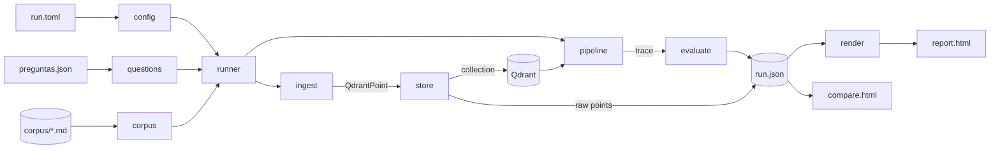

# Design: hermes-report-generator

Status: approved (2026-10-21, decisions by José in the chat of that day)

## 1. Summary

A command-line tool that runs the whole Hermes pipeline (Ingest → Qdrant →
Retrieve → Enrich → Generator) over a folder of Markdown files and a JSON
file of questions with their expected answers, grades every answer, and
writes:

- `run.json`: everything the run saw and produced (the run record);
- `report.html`: one self-contained report rendered from `run.json`.

`hermes-report compare` renders one comparison report from several
`run.json` files (another model, another `top_k`, another budget...).

It is the standard version of the playground of hermes-generator
(`playground/` on its `dev` branch). The playground stays as it is: this
repository ports its tracing, its rule evaluation and its report, and adds
what it lacked: any corpus, a reproducible run file, the raw chunks as they
are stored in Qdrant, an LLM judge and the comparison.

## 2. Decisions (José, 2026-10-21)

| Question | Decision |
|---|---|
| How to use the modules | Git dependencies in one venv, pinned by commit; everything runs in process |
| Raw chunks | Both: a global explorer of the whole collection, and per question the raw chunks of the documents it touched |
| Grading | Rules (keywords and evidence phrases) plus an LLM judge |
| Comparing runs | Yes: each run writes `run.json`; `compare` renders several |
| Describing a run | A TOML run file; CLI flags override some keys; the resolved copy is saved with the report |
| Vectors | Qdrant server (`QDRANT_URL`), one collection per corpus and ingestion setup, reused when nothing changed |
| GitHub | José creates `Jdorta62/hermes-report-generator`; `main` and `dev` are pushed when an epic closes |
| Language | Report and CLI messages in Spanish; code, comments and docstrings in English |

## 3. Inputs

### 3.1 Run file (TOML)

Relative paths are resolved against the directory of the run file.

```toml
title = "Don Quijote"                 # required
description = "Batería de 11 preguntas"  # optional

[corpus]
dir = "corpus"                        # required: folder of .md files
glob = "**/*.md"                      # default

[questions]
file = "preguntas.json"               # required

[ingest]                              # MarkdownStructuralChunker arguments
max_chunk_size = 1500                 # default
hard_boundary_levels = [1, 2]         # default
strip_frontmatter = true              # default

[embedding]
provider = "ollama"                   # ollama (default) | hash (tests)
model = "nomic-embed-text"            # default

[qdrant]
url = "http://localhost:6333"         # default: $QDRANT_URL or this; ":memory:" for tests
collection = ""                       # default "": derived (§5.2); must start with "hermes_report_"

[retrieval]
top_k = 10                            # default
candidate_factor = 1                  # default
# score_threshold = 0.3               # optional

[enrich]
chain = ["neighbors", "merge", "doc_order"]  # default
max_context_tokens = 3000             # default; 0 = no limit
# max_chunks = 20                     # optional

[generation]
provider = "ollama"                   # ollama (default) | echo (tests)
model = "qwen3:4b"                    # default: $OLLAMA_MODEL or this
temperature = 0.0                     # default
seed = 42                             # default
response_format = "plain"             # plain (default) | markdown | bullets
# insufficient_message = "No lo sé con estas fuentes."

[judge]
enabled = true                        # default
provider = "ollama"                   # default: same as generation.provider
model = ""                            # default "": generation.model

[output]
dir = "out"                           # default; each run gets its own sub-folder
cache_dir = ".hermes-report-cache"    # default; ingestion cache
```

Unknown keys are an error, so a typo never passes silently. Ollama is reached
at `$OLLAMA_HOST` (default `http://localhost:11434`).

CLI overrides: `--model` (generation.model), `--judge-model`, `--no-judge`,
`--top-k`, `--budget` (enrich.max_context_tokens), `--out` (output.dir),
`--only ID` (repeatable: run only these questions), `--reingest` (ignore the
cache and reload the collection).

### 3.2 Questions file (JSON)

```json
{
  "title": "Batería del Quijote",
  "questions": [
    {
      "id": "q01",
      "question": "¿Cuántos días tardó don Quijote en ponerle nombre a su rocín?",
      "expected": "Cuatro días; lo llamó Rocinante.",
      "keywords": ["cuatro", "Rocinante"],
      "evidence": ["Cuatro días se le pasaron en imaginar qué nombre le pondría"],
      "documents": ["primera-parte/capitulo-01.md"]
    },
    {
      "id": "q11",
      "question": "¿En qué año murió Sancho Panza?",
      "expected": "El libro no lo dice.",
      "refusal": true
    }
  ]
}
```

| Field | Required | Meaning |
|---|---|---|
| `id` | no | Unique; default `q01`, `q02`... by position |
| `question` | yes | The user question |
| `expected` | yes | The right answer, for the reader and the judge |
| `keywords` | no | Words that must all appear in a right answer (case and accents ignored) |
| `evidence` | no | Phrases of the corpus that must all be in the context for the answer to be reachable |
| `documents` | no | Corpus files (relative to `corpus.dir`) that hold the answer; must exist |
| `refusal` | no | `true` when the right outcome is to say the sources are not enough |

## 4. Module map

```
src/hermes_report/
├── __init__.py      version and public entry points
├── __main__.py      python -m hermes_report
├── cli.py           hermes-report run | render | compare
├── config.py        RunConfig and its sections, load_config, ConfigError
├── questions.py     Question, QuestionSet, load_questions, normalise, QuestionsError
├── corpus.py        CorpusDocument, Corpus, load_corpus, CorpusError
├── record.py        run.json schema (TypedDict), SCHEMA_VERSION, read/write, converters
├── providers.py     OllamaEmbedder, HashEmbedder, EchoLLM, make_embedder, make_llm, check_ollama
├── ingest.py        ingest_corpus (hermes-ingest-md + per-document cache)
├── store.py         collection_name, ensure_collection, read_points (raw Qdrant points)
├── trace.py         tracing wrappers (ported from the playground)
├── pipeline.py      answer_question: retrieve → enrich → generate, traced
├── evaluate.py      rule_verdict, judge
├── runner.py        run(config) -> RunRecord, with progress lines
└── render/
    ├── __init__.py  render_run, render_compare
    ├── html.py      shared helpers (escape, sections, chips, status labels)
    ├── run.py       the report of one run
    ├── compare.py   the comparison report
    └── assets/      report.css, report.js (package data, inlined into the HTML)
```



Dependencies: `hermes-core` (tag v0.6.0), `hermes-ingest-md`,
`hermes-retrieval`, `hermes-enrich`, `hermes-generator[ollama]` (each pinned
to a commit) and `qdrant-client`. TOML and JSON come from the standard
library. No other dependency.

## 5. Phases

### 5.1 Corpus and ingestion

- `load_corpus` lists `glob` under `dir`, sorted by relative path; each file
  is a `CorpusDocument(source, path, sha256, chars)`. `source` is the path
  relative to `dir` with `/` separators: it is the `filename` given to the
  ingester, so it becomes `payload["source"]`.
- `ingest_corpus` runs `MarkdownIngester(embedder,
  chunker=MarkdownStructuralChunker(...))` once per document. Each
  document's points are cached in `cache_dir` as JSON lines, keyed by the
  document sha256, the chunker arguments, the embedding provider and model,
  and the `hermes-ingest-md` version. `--reingest` ignores the cache.

### 5.2 Qdrant collection

- Name: `collection` if set, else `hermes_report_<slug(title)>_<key8>`.
  `key8` is the first 8 hex digits of the sha256 of the corpus fingerprint
  (sorted `source:sha256` pairs) and the ingestion key. Only collections whose
  name starts with `hermes_report_` are ever created, deleted or written.
- `ensure_collection` reuses the collection when it holds exactly the
  ingested point ids, and otherwise recreates it. Payload indexes `doc_id`
  (keyword) and `chunk_index` (integer) are needed by `neighbors`.
- `read_points` scrolls the whole collection with payloads and vectors.
  This is the raw view, as stored in Qdrant, not as the ingester returned
  it. Each vector is summarised (dimension, norm, first 8 values) in the
  record.

### 5.3 Per question

```python
def answer_question(question, ctx) -> QuestionRecord:
    query = UserQuery(text=question.question, query_id=question.id)
    retrieval = ctx.retriever.retrieve(query, SearchScope([ctx.collection]),
                                       search_params, pipeline_control)  # timed
    trace = Trace()
    context = HermesEnrich(qdrant, enrichers=traced builtins, token_counter)
                .enrich(query, retrieval, budget, EnrichmentControl(chain))  # timed
    result = HermesGenerator(TracingLLM(llm, trace),
                             strategies={"default": TracingStrategy(DefaultStrategy(), trace)},
                             default_generation_params=params)
                .generate(query, context, pipeline_control=GenerationControl(
                    response_format, ResponseOptions(insufficient_message), include_prompt=True))
    rules = rule_verdict(question, retrieval, context, result)
    judge = judge(question, result, ctx.judge_llm) if enabled else None
    RETURN record of all of it; any exception is caught and stored as `error`
```

### 5.4 Grading

Rules (ported from the playground's `evaluate`), verdict codes:

| Code | When |
|---|---|
| `error` | the pipeline raised |
| `correct_refusal` / `invented_answer` | `refusal` question: refused / did not |
| `correct` | keywords match and the evidence is in the context (or no evidence given) |
| `correct_without_evidence` | keywords match, evidence not in the context |
| `budget_failure` | wrong, evidence retrieved but dropped before the context |
| `retrieval_failure` | wrong, evidence never retrieved |
| `generation_refused` | refused with the evidence in the context |
| `generation_wrong` | wrong with the evidence in the context, or no evidence given |
| `unrated` | no keywords: only the judge grades it |

The judge gets the question, the expected answer, whether a refusal is
expected and the answer, and replies JSON `{"verdict": "correct" | "partial"
| "incorrect", "reason": "..."}` (Ollama `format="json"`, temperature 0). An
unparseable reply is recorded with its raw text and `verdict: null`. The
report flags when rules and judge disagree.

## 6. Run record (`run.json`, schema 1)

`TypedDict`s in `record.py`; `write_record` / `read_record` (which rejects
another schema version). Hermes objects are stored as
`dataclasses.asdict`-style dicts. Vectors are summarised, never stored in
full.

```
RunRecord: schema, title, description, started_at, finished_at, seconds,
           config (resolved run file as a dict), environment, corpus, ingest,
           collection, points, questions
EnvironmentRecord: python, packages {name: version}, ollama_host, qdrant_url
CorpusRecord: dir, glob, documents [DocumentRecord: source, sha256, chars, chunks]
IngestRecord: seconds, chunker {...}, embedding {provider, model, dimension},
              documents [{source, chunks, seconds, cached}]
CollectionRecord: name, url, reloaded, points, vector_size, distance, indexes
PointRecord: id, payload {...}, vector {dimension, norm, head}
QuestionRecord: spec (the Question), query_id, seconds, error,
  retrieval {seconds, chunks [RetrievedChunk], queries [SearchedQuery]},
  enrich {seconds, steps [StepRecord], context ContextRecord | None},
  generation {seconds, llm_calls [LLMCallRecord], result GenerationResult | None},
  rules RuleRecord, judge JudgeRecord | None
StepRecord: name, phase, seconds, before, after (ContextRecord),
            reads [{ranges [ChunkRange], returned [chunk_id]}]
ContextRecord: pieces [{text, transforms, chunks [{chunk_id, collection_name,
               doc_id, chunk_index, score, origin}]}], enrichments,
               dropped_chunk_ids, query_id
LLMCallRecord: messages [{role, content}], params, reply {text, model} | None, error, seconds
RuleRecord: verdict, in_retrieval, in_context, in_cited, answer_ok, retrieved_rank, expected_docs_retrieved
JudgeRecord: verdict, reason, model, seconds, raw, error
```

## 7. Report (`report.html`)

Self-contained (CSS and JS inlined), in Spanish, rendered only from the
record, so `hermes-report render run.json` gives the same HTML again. Tabs:

1. **Resumen**: score tiles (rules and judge), one row per question
   (verdict, judge, disagreement flag, first evidence rank, seconds), the
   resolved run file and the environment (package versions, models, URLs).
2. **Corpus e ingesta**: documents (source, characters, chunks, cached,
   seconds), chunker arguments, embedding model and dimension, chunk size
   statistics, and the collection (name, URL, points, vector size, distance,
   indexes, reused or reloaded).
3. **Chunks en Qdrant**: the global explorer. Every point of the
   collection with its id, `source`, `chunk_index`, offsets, `heading_path`,
   size, text, its raw payload as JSON and its vector summary. Filters by
   document and by text. A "marcar pregunta" selector colours each chunk by
   its state for that question: retrieved, added by enrichment, in the final
   context, cited, dropped.
4. **One tab per question**, with every phase as a section: the question and
   evaluation card (rules and judge, expected answer, keywords, evidence);
   the document map (one row per document touched or expected, one cell per
   `chunk_index`, coloured by state); the retrieval (searched queries, hits
   and scores); the seed; each enrichment step with its Qdrant reads; the
   budget fit and the `EnrichedContext`; the prompt; the LLM calls (raw);
   the `GenerationResult` and citations; the judge (prompt and raw reply);
   and **Documentos tocados (crudo)**, all the chunks of the documents the
   question touched, in order, with raw payload and state.

The points are embedded once as JSON (`<script type="application/json">`)
and `report.js` renders the explorer and the raw documents from it, so a
large corpus is not copied once per question. Everything else is rendered in
Python. The hash in the URL selects the tab (`#q-q05`,
`#chunks?doc=<source>&q=<id>`).

## 8. Comparison (`compare.html`)

`hermes-report compare a/run.json b/run.json ... [--out compare.html]`:

- the run-file keys that differ between runs;
- tiles per run (right answers by rules and by judge, failures by type,
  mean seconds per question);
- a matrix with one row per question id and one column per run (rule
  verdict and judge chip), linking to each run's `report.html#q-<id>`
  (path relative to the comparison file).

Runs over different question sets are allowed; a question missing in a run
shows `—`.

## 9. Output layout and CLI

```
<output.dir>/<YYYYmmdd-HHMMSS>-<slug(title)>/
├── run.toml      the resolved run file (defaults and overrides applied)
├── run.json
└── report.html
```

```
hermes-report run RUN_TOML [--model M] [--judge-model M] [--no-judge]
                  [--top-k N] [--budget N] [--out DIR] [--only ID ...] [--reingest]
hermes-report render RUN_JSON [--out report.html]
hermes-report compare RUN_JSON ... [--out compare.html]
```

Exit codes: 0 ok, 1 some question raised, 2 bad input or a service
unreachable (message in Spanish on stderr).

## 10. Tests

- No test touches José's resources: Qdrant `":memory:"`, `HashEmbedder`
  (deterministic bag of hashed words, 256 dimensions) and `EchoLLM`
  (answers with the first sentence of source `[1]`, or
  `INSUFFICIENT_CONTEXT` when there are no sources).
- A small invented demo corpus and questions under `examples/demo/` run end
  to end in the test suite.
- An `integration` marker for real Ollama and Qdrant; skipped when they are
  unreachable.

## 11. Risks

- Five private repositories: CI needs one read token for all of them
  (FU-1). Until then CI fails at `uv sync`.
- `llama-index-core` comes with hermes-ingest-md: a heavy install, accepted.
- The pinned commits must be bumped by hand when a module changes.
